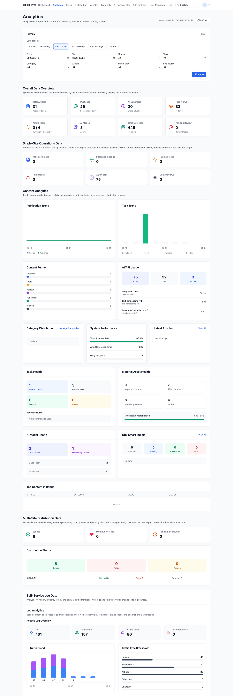
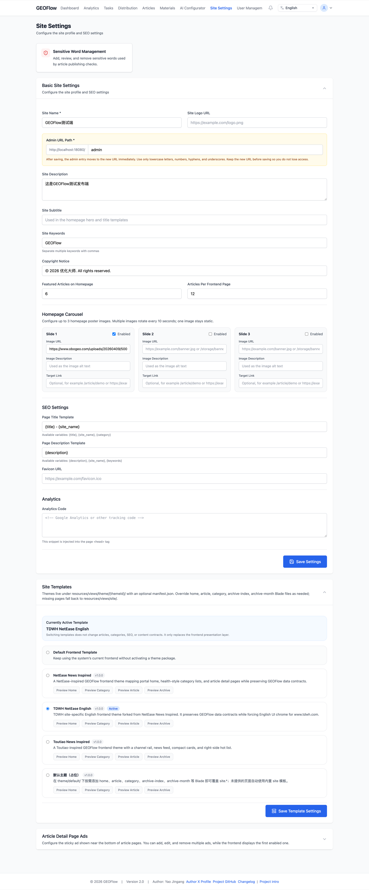
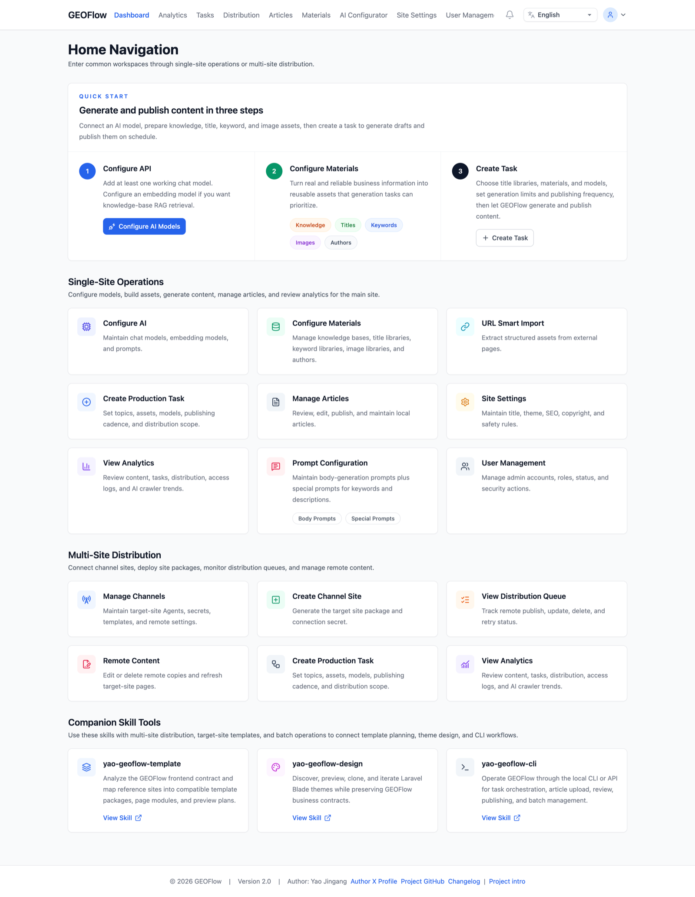
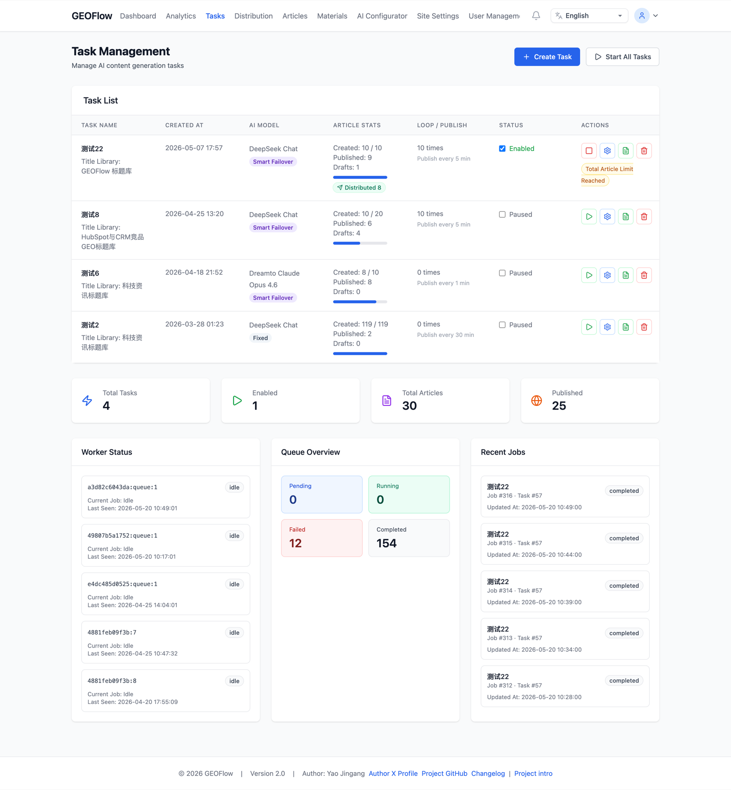
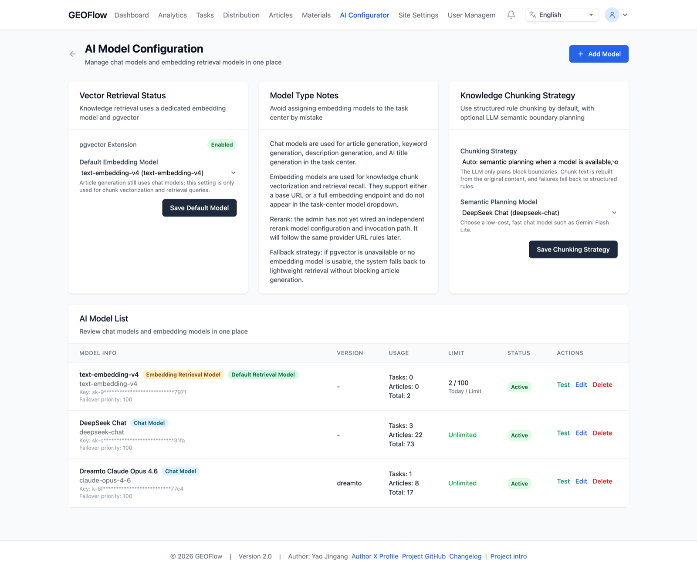
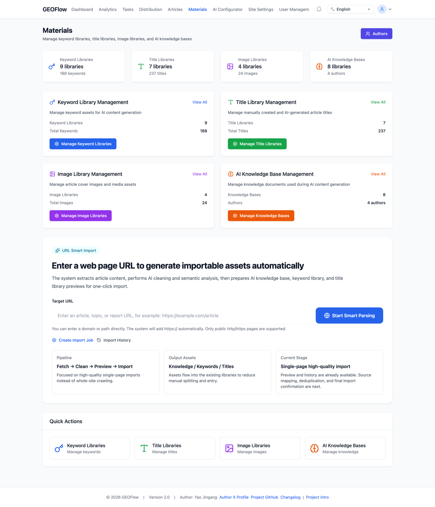

# GEOFlow

> 语言：[简体中文](../../README.md) | [英语](README_en.md) | [日语](README_ja.md) | [西班牙语](README_es.md) | [俄语](README_ru.md) | [葡萄牙语（巴西）](README_pt_BR.md)

> GEOFlow 是一套开源的 GEO（Generative Engine Optimization）内容工程与多站点分发系统。它把知识库、素材库、提示词、AI 生成任务、审核与发布、分析、GEOFlow Agent 目标站点包、WordPress REST 渠道、通用 HTTP API 渠道和远端静态页面分发连接起来，形成一条可维护的工作流，将可信信息转化为可发布、可追踪、可分发、可多渠道传播的 GEO 内容资产。

[](https://www.php.net/)
[](https://www.postgresql.org/)
[](https://docs.docker.com/compose/)
[](../../LICENSE)
[](https://github.com/zhangzhirongs/GEOflow/stargazers)
[](https://github.com/zhangzhirongs/GEOflow/network/members)
[](https://github.com/zhangzhirongs/GEOflow/issues)

GEOFlow 依据 [Apache License 2.0](../../LICENSE) 发布。你可以使用、复制、修改和分发它，包括用于商业目的，前提是保留版权声明和许可证声明，并遵守 Apache-2.0 的专利、商标和免责条款。

---

## ✨ 你可以做什么

| 特性 | 描述 |
|----------------|-------------|
| 🤖 多模型生成 | OpenAI 风格 API 和 Gemini 原生端点、chat / embedding 模型、URL 适配、智能故障转移、重试和使用统计 |
| 🧠 知识库 RAG | 基于规则的分块、可选的 LLM 语义规划、稳定回退、使用 embedding 模型生成向量，并在生成过程中检索上下文 |
| 🗂 素材与提示词 | 标题、关键词、图片、作者、知识库、正文提示词和特殊提示词 |
| 📦 任务自动化 | 生成限制、草稿池、审核、发布节奏、队列、重试、发布范围以及按任务筛选 |
| 📋 审核与文章 | 草稿、审核、发布、回收站、作者、分类、SEO 和任务来源，集成于单一流程 |
| 📡 多站点分发 | GEOFlow Agent 渠道、WordPress REST 和通用 HTTP API、密钥、目标站点包、静态模式、rewrite 规则、远程编辑/删除、队列和日志 |
| 🧾 目标站点包 | 每个渠道的 PHP 智能体包，包含首页、文章页面、静态 assets、sitemap、`llms.txt` / TXT 地图和 Schema |
| 📊 分析 | 全局视图、单站点运营、多站点分发、访问日志、热门内容、AI 爬虫和趋势 |
| 🔍 SEO 与 LLM 友好输出 | SEO、Open Graph、Schema、Markdown GFM、独立 CSS、图片同步、sitemap 和 TXT 地图 |
| 🎨 前台与主题 | 主题、预览、从后台切换，以及标题、版权、主题和分类的远程同步 |
| 🌍 管理后台 i18n | 中文、英语、日语、西班牙语、俄语和葡萄牙语（巴西），涵盖 GEOFlow 2.0 模块 |
| 🔔 版本通知 | 查询 GitHub 的 `version.json`，并在有新版本时发出通知 |
| 🐳 可直接部署 | **Docker Compose**：Postgres（pgvector）、Redis、应用、队列、调度器、Reverb 以及使用 Nginx/php-fpm 的生产环境 |

---

## GEOFlow CLI 0.2.0

该仓库包含 `bin/geoflow`，用于通过 API v1 管理目录、任务、作业、材料和文章。官方兼容性覆盖 macOS、Linux 和 WSL。在原生 Windows 中，配置文件的 ACL 权限需要手动验证。

[CLI 英文完整指南](../GEOFLOW_CLI_en.md)

---

## 🖼 界面预览

<table>
  <tr>
    <td width="34%" rowspan="3"><br /><sub>分析</sub></td>
    <td width="33%" rowspan="2"><br /><sub>站点设置</sub></td>
    <td width="33%"><br /><sub>管理后台</sub></td>
  </tr>
  <tr>
    <td width="33%"><br /><sub>任务管理</sub></td>
  </tr>
  <tr>
    <td width="33%"><br /><sub>AI 模型配置</sub></td>
    <td width="33%"><br /><sub>素材</sub></td>
  </tr>
</table>

涵盖管理面板、分析、任务、素材、模型配置和站点设置。

---

## 🆕 新版本亮点

GEOFlow 2.0 包含以下关键变更：

- **面板作为运营中枢**：保留三步引导，并按单站点运营、多站点分发和补充技能组织入口。
- **Gemini 与 OpenAI-compatible 提供商**：模型配置覆盖 OpenAI-style 路由以及原生 Gemini 的 chat / embedding。
- **知识语义分块**：支持结构化规则、自动模式或可选的 LLM 语义规划；LLM 仅规划边界，最终分块从原始文本重建。
- **独立分析页面**：全局视图、内容运营、任务/材料健康度、分发状态、访问日志以及 `/admin/analytics` 中的 AI 爬虫趋势。
- **端到端可用的分发**：GEOFlow Agent、WordPress REST 和通用 HTTP API 渠道，密钥，连接测试，目标站点包，静态/rewrite 模式，远程设置同步，队列，日志，远程编辑和删除。
- **显式发布范围**：一个任务可以发布到本地和渠道、仅发布到渠道，或仅发布到本地 GEOFlow 站点；本地模式会禁用渠道选择。
- **目标站点采用静态模式**：分发会重新生成远程首页、文章页、sitemap、TXT 地图、`llms.txt`、图片和独立 CSS。
- **材料与 RAG 更完整**：分块、向量化状态、标题、关键词、图片、作者和 prompts 构成任务的输入层。
- **部署和安全性增强**：生产 Docker 使用 Nginx + PHP-FPM，seeder 不会覆盖现有管理员，Docker/Composer 镜像可配置。
- **当前模块的 i18n 覆盖**：GEOFlow 2.0 模块不再依赖未翻译的键或英文回退。

---

## 🏗 执行结构

```
Panel admin
  ↓
Configuración IA / materiales / prompts / tareas
  ↓
Scheduler / cola / worker ejecuta la IA
  ↓
Borrador / revisión / publicación
  ↓
Artículos locales y páginas SEO
  ↓
Cola de distribución / Agent del sitio destino
  ↓
Home remota, artículos, sitemap, mapas TXT y llms.txt
```

---

## 🧱 系统架构

| 层级 | 描述 |
|------|-------------|
| Web / 管理后台 | **Laravel**：路由、控制器、文章站点、**Blade** 管理后台、分析、分发、素材和任务 |
| API / 智能体 | 本地 API 与目标站点的 PHP 智能体，用于健康检查、接收/更新/删除文章、同步设置和生成静态文件 |
| Scheduler / 队列 / Reverb | **Scheduler**、用于生成和分发的 **`queue:work` / Horizon**，如适用则 **Reverb** |
| 域与任务 | `app/Services`、`app/Jobs`、`app/Http/Controllers`，用于 AI、RAG、发布、分发和日志分析 |
| 持久化 | **PostgreSQL**（推荐 **pgvector**）+ **Redis** + 目标站点中的 JSON/静态文件 |

主流程：配置模型和提示词 → 准备知识库、标题、关键词、图片和作者 → 创建任务并加入队列 → worker 生成内容 → 草稿 / 审核 / 发布 → 本地 SEO 页面 → 分发到选定渠道 → 生产、分发、访问和 AI 爬虫分析。

---

## ⚡ 管理员快速开始

1. **配置 API**：至少添加一个可用的聊天模型；如果需要 RAG，请添加一个 embedding 模型并选择一种分块策略。
2. **配置素材**：基于真实且可验证的信息准备知识库、标题库、关键词库、图片库和作者库。
3. **创建任务**：选择素材、模型、生成数量、频率和发布范围；在启用自动发布和多站点分发之前，先以草稿或审核流程开始。

---

## 🎯 用例与预期结果

GEOFlow 非常适合这些实际场景：

- **独立的 GEO 站点**
  用于运营一个以 FAQ、产品内容、案例和品牌知识为核心的站点。目标是提升 AI 搜索可见性和运营效率，而不是生产低价值页面。
- **官方站点内的 GEO 子渠道**
  用于在现有站点内添加新闻、知识或解决方案渠道。目标是更好地组织内容并便于维护。
- **独立的 GEO 来源站点**
  用于围绕特定主题或行业积累指南、排名、分析和文章。目标是构建可信的内容资产，而不是用噪音污染互联网。
- **内部 GEO 内容管理系统**
  用于将 GEOFlow 作为模型、素材、提示词、知识、审核和发布的内部后端。目标是提高团队效率。
- **多站点或多渠道 GEO 部署**
  用于以同一运营模式管理多个站点、渠道或主题。目标是标准化内容生产与分发。
- **来源与分发的自动化管理**
  用于将知识库、编辑更新和分发作为内容工程来处理。目标是让有价值的信息更稳定、更易理解且更易检索。

系统价值必须建立在**真实、高质量且维护良好的知识库**之上。
GEOFlow 并非旨在制造虚假信息，也不是为了让网络过载。其目的是通过可信内容提升 AI 营销和 GEO 运营的效率。

---

## 🧭 推荐的部署和使用方式

- **作为独立的 GEO 网站**
  部署完整前端和后台管理面板，并将其作为独立编辑资产使用。
- **作为现有站点的 GEO 子渠道**
  可在子域名、目录或专用渠道下使用，无需重建整个主站。
- **作为 GEO 来源站点**
  优先构建知识库，然后通过任务自动化更新。
- **作为内部 GEO 内容后端**
  将面板、模型、素材、队列、API 和编辑流程用作内部基础设施。
- **作为多站点或多渠道系统**
  为多个渠道、品牌或实验复用工作流、模板和流程。
- **作为自动化来源管理系统**
  将标题、图像和提示词库以及知识库视为长期基础设施。

推荐顺序：

1. 首先定义真实目标和真实受众
2. 先构建知识库
3. 确保内容可验证且可维护
4. 之后才使用自动化来提升效率

如果知识库薄弱，自动化只会放大噪声。在 GEOFlow 中，**知识库的质量必须优先**。

---

## 🚀 快速开始

### 选项 1：Docker（开发 / 演示）

```bash
git clone https://github.com/zhangzhirongs/GEOflow.git
cd GEOFlow
cp .env.example .env
vi .env

docker compose build
docker compose up -d
```

- 站点：`http://localhost:18080`（端口 **`APP_PORT`**，默认 `18080`）
- 管理端：`http://localhost:18080/geo_admin/login`（**`ADMIN_BASE_PATH`**，默认 `geo_admin`）

使用 **`docker-compose.yml`** 时，服务 **`init`** 执行迁移并 `php artisan geoflow:install`；初始数据仅在数据库为空时写入（默认 admin：见下文）。

### 补充：Docker（生产）

在生产环境中使用 **`docker-compose.prod.yml`** 搭配 **Nginx + php-fpm**，而不是 `php artisan serve`。

```bash
cp .env.prod.example .env.prod
vi .env.prod

docker compose --env-file .env.prod -f docker-compose.prod.yml build
docker compose --env-file .env.prod -f docker-compose.prod.yml up -d postgres redis
docker compose --env-file .env.prod -f docker-compose.prod.yml up -d init
docker compose --env-file .env.prod -f docker-compose.prod.yml up -d app web queue scheduler reverb
```

- 前端和管理后台通过 `web`（Nginx）进入；PHP 位于 `app`（php-fpm）。
- **首次安装：** 生产环境的 `init` 服务先执行迁移，然后执行 `php artisan geoflow:install`。此顺序仅适用于空数据库。已有数据或迁移历史的安装必须遵循 `../../docs/deployment/DEPLOYMENT.md` 第 3.1 节的停止与排空协议。
- 更多详情：**`../../docs/deployment/DEPLOYMENT.md`**。

### 选项 2：本地 PHP

**要求：** PHP **8.3+**（`pdo_pgsql`、`redis` 等）、**PostgreSQL**、**Redis**、**Composer 2.x**。

```bash
git clone https://github.com/zhangzhirongs/GEOflow.git
cd GEOFlow
cp .env.example .env
composer install --no-interaction --prefer-dist
php artisan key:generate

GEOFLOW_SECURITY_FRESH_INSTALL_CONFIRMED=true php artisan migrate --force
php artisan geoflow:install
php artisan storage:link

php artisan serve --host=127.0.0.1 --port=8080
```

其他终端：

```bash
php artisan queue:work redis --queue=geoflow,distribution,default --sleep=1 --tries=1 --timeout=300
php artisan schedule:work
php artisan reverb:start
```

管理后台：`http://127.0.0.1:8080/geo_admin/login`。**生产环境：** Nginx + PHP-FPM，根目录 **`public/`**。

---

## 默认凭据（在 `geoflow:install` 之后）

| 字段 | 值 |
|-------|--------|
| 用户 | `GEOFLOW_ADMIN_USERNAME`，默认为 `admin` |
| 密码 | 在本地开发中为 `password`；在生产环境中定义 `GEOFLOW_ADMIN_PASSWORD`。如果为空且账户尚不存在，安装程序会在 init 日志 / `geoflow:install` 中生成一次性随机密码。 |

`geoflow:install` 仅在数据库为空时执行初始数据填充。如果检测到用户数据或业务数据，则只写入安装标记并跳过 seed。admin seeder 仍保持幂等，且不会覆盖现有的用户名、邮箱或密码。

在全新空数据库中，`geoflow:install` 会激活 Enterprise Signature 21 并导入包含 50 篇参考文章的数据包。使用 `--without-demo` 进行最小安装。带有数据的站点会保留其主题、配置、作者、分类和文章。对于手动导入，请配置 `GEOFLOW_SEED_FRONTEND_DEMO=true` 并执行 `php artisan db:seed --force`；默认模式仅补全缺失行。将 `GEOFLOW_SEED_FRONTEND_DEMO_OVERWRITE=true` 保留给可重置的演示数据库。

### 失败尝试锁定与手动解锁

- 管理员账户在连续 **5** 次失败尝试后会自动锁定（`status=locked`）。
- 被锁定的账户在管理员手动解锁之前无法登录。
- 解锁命令：

```bash
php artisan geoflow:admin-unlock <username>
```

示例：

```bash
php artisan geoflow:admin-unlock admin
```

---

## Docker（摘要）

**开发**（`docker-compose.yml`）：`postgres`、`redis`、`init`、`app`（`${APP_PORT:-18080}:8080`）、`queue`、`scheduler`、`reverb`（`${REVERB_EXPOSE_PORT:-18081}:8080`）。`docker/entrypoint.sh` 的变量：与 [GEOFlow](README_en.md) 中相同。

**生产环境**（`docker-compose.prod.yml`）：使用 `docker compose --env-file .env.prod -f docker-compose.prod.yml …`（参见上方补充内容和 `../../docs/deployment/DEPLOYMENT.md`）。

---

## 开发与测试

```bash
composer test
./vendor/bin/pint
```

---

## 🌍 其他语言

- [简体中文](../../README.md)
- [英文](README_en.md)
- [日本語](README_ja.md)
- [俄语](README_ru.md)

---

## 📄 许可证

GEOFlow 根据 [Apache License 2.0](../../LICENSE) 授权。它允许个人和商业使用、修改、再分发和私有部署，前提是遵守许可证声明、版权声明、变更声明、专利条款和免责声明。

---

## ⭐ Star 趋势

[](https://star-history.com/#zhangzhirongs/GEOflow&Date)
